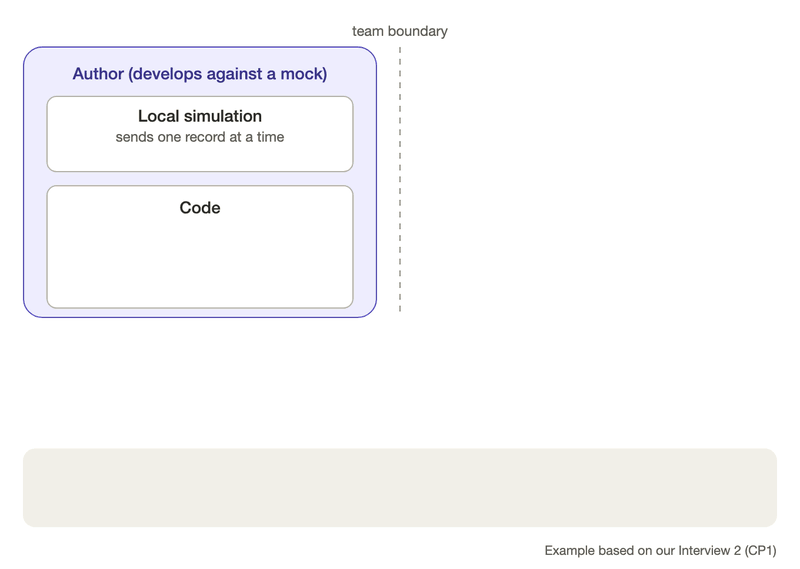
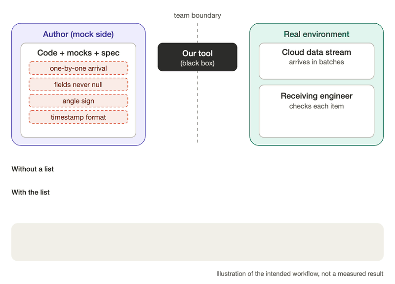

# AI-Intro — Mock-to-Real Handoff Checklist (Group 23, CSIC30216 Fall 2026)
 
> **Status (2026-11-23): not runnable yet.** `main` currently contains only design and
> process documents. There is no executable code. See "Plan to get it running" below.
 
## The problem
 
An engineer who develops against a mock or a local simulation builds assumptions into the
code about how the real environment behaves: field formats, null values, units and sign
conventions, and runtime behaviour such as batching, ordering, pagination and rate limits.
These assumptions are rarely written down. The engineer who runs the real environment,
often on another team, does not know which ones the code depends on, so mismatches show up
after deployment, one failure at a time.


 
Evidence so far (details in our CP1 report): one interviewee simulated a real-time stream
one record at a time; in the cloud, data arrived in batches of up to two hours. Fixing it
took 2–3 rounds of about one week each. We have **not yet interviewed anyone from the
receiving side**.
 
## What the tool will do
 
A Python-focused CLI that scans a project **before integration** and drafts a
`HANDOFF.md` checklist for humans to review.
 
- **Input:** source files, mocks, fixtures and (optionally) specifications that the user selects.
- **Output:** `HANDOFF.md`. Each item has: the assumption, file/line reference, category,
  how to verify it in the real environment, and a status (`verified` / `mismatch` / `uncertain`).
### Two-person workflow
 
1. **Author** (mock side) runs the tool, corrects and adds to the draft, and includes
   `HANDOFF.md` in the PR.
2. **Receiving engineer** (real-environment side) checks each item against the real
   environment and records evidence or a question.
3. The author resolves the open items. Rescanning flags changed entries for rechecking.
4. The handoff is done when every item is `verified`.



### Planned pipeline (first end-to-end version)
 
```
[1] select input files  →  [2] find mocks / fixtures / hard-coded sample data
    →  [3] LLM drafts assumptions + verification steps  →  [4] write HANDOFF.md
```
 
## Where AI is used, and what happens when it is wrong
 
The AI only **proposes** assumptions and verification steps. Humans approve the checklist,
verify the results and decide on fixes. The AI cannot mark items verified, modify code,
access credentials, deploy or merge PRs.
 
| Failure | What the user sees / does |
|---|---|
| AI flags something that is not a real assumption (false positive) | The author deletes or edits the item before the handoff. |
| AI misses an assumption (false negative) | `HANDOFF.md` is marked "AI-drafted, may be incomplete". The author adds items by hand, and the receiving engineer can add items too. |
| LLM call fails, times out or returns malformed output | The CLI stops with a clear error, writes no partial `HANDOFF.md`, and still lists the mocks/fixtures found in step [2] so the author can write items by hand. |
| Input contains secrets (`.env`, keys) | Sensitive files are filtered out before anything is sent to the LLM. *(Filter rules still to be defined — see DECISIONS.md.)* |
 
## How to run
 
*Not available yet.* Target: a first end-to-end run (pipeline steps 1–4 on our sample
project) by the walking skeleton session. See `DECISIONS.md` → "Plan to get the main task running".
 
## Repository guide
 
- `DECISIONS.md` — decision log (code steward, evaluation design, Phase 2 plan)
- `AI_GUIDELINES.md` — how our team uses AI tools
- `DRAFT_PLAN.md` — early Phase 1 draft. **Superseded by CP1** for participant numbers
  (we now plan 4 participants, 2 per condition).
- `.github/PULL_REQUEST_TEMPLATE.md` — PR template
## Team
 
吳弘叡 (x85432), 鐘邦郡 (bonginn), 鄧皓澤 (DanielTeng0811), 方騏為 (Cactex)
 