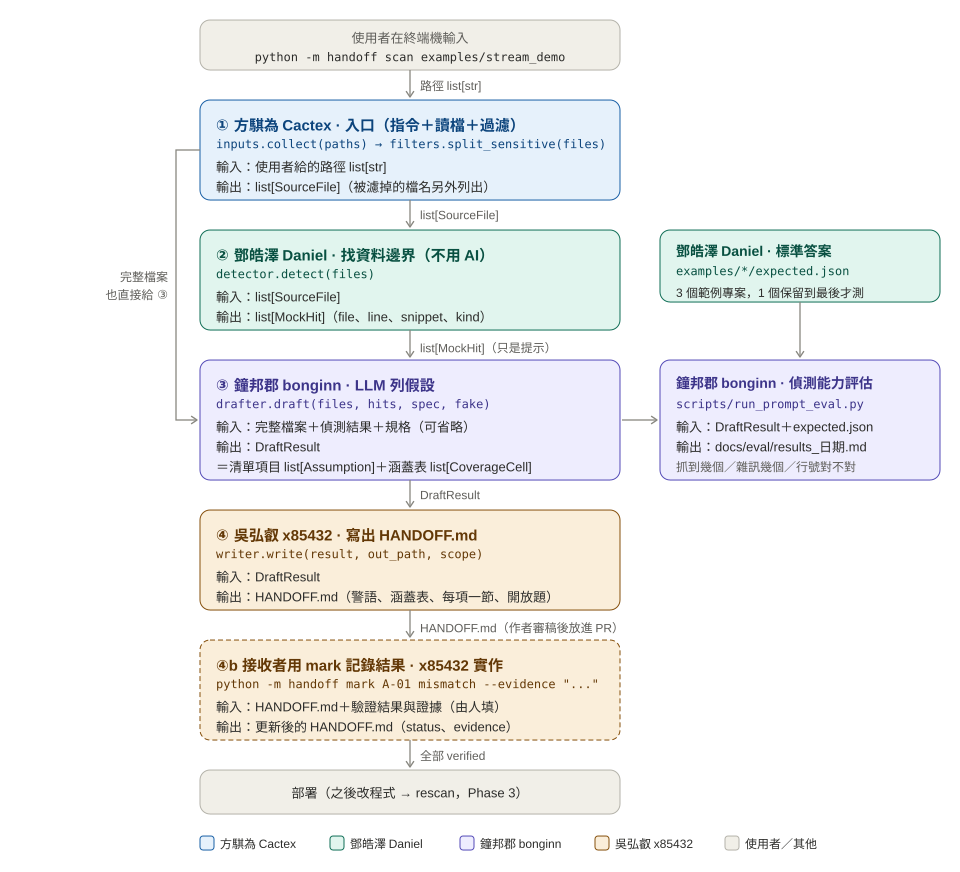

# `handoff` package guide

Read this before you write code in `handoff/`. It explains why the package exists, how the
four pieces fit together, and how to work on your piece without breaking anyone else's.
The full plan, in Chinese, is in [`docs/CP2_PLAN.md`](../docs/CP2_PLAN.md).

> **Status (2026-11-23): skeleton only.** The shared formats (`models.py`), shared fake data
> (`fakes.py`) and contract tests are in place. Every function in the other modules raises
> `NotImplementedError` until its owner fills it in at the walking skeleton session.

## Why this exists

An engineer who builds against a mock or a local simulation writes assumptions into the code
about the real environment: field formats, null values, units, and runtime behaviour such as
data arriving in batches. Nobody writes these down, so the engineer who runs the real
environment, often on another team, finds them only after deployment, one failure at a time.
In our Interview 2, a stream simulated one record at a time broke in the cloud, where up to two
hours of data arrived at once; fixing it took 2–3 rounds of about a week each.

This package scans a project **before integration** and drafts `HANDOFF.md`: a checklist of
those assumptions, each with a question for the receiving engineer and a way to verify it.
Humans review, verify and decide. See the animations in the [main README](../README.md).

## The pipeline



```
python -m handoff scan PATH...
  ① inputs.collect + filters.split_sensitive  -> list[SourceFile]
  ② detector.detect                           -> list[MockHit]      (hints only)
  ③ drafter.draft(files, hits, spec)          -> DraftResult        (items + coverage table)
  ④ writer.write                              -> HANDOFF.md
python -m handoff mark A-01 mismatch --evidence "..."   (a human records a result)
```

## Who owns what

| # | File | Owner | Function | Input | Output |
|---|---|---|---|---|---|
| ① | `cli.py`, `inputs.py`, `filters.py` | 方騏為 Cactex | `cli.main`, `collect`, `split_sensitive` | command line, paths | `list[SourceFile]` (secret-looking files skipped and listed) |
| ② | `detector.py` | 鄧皓澤 Daniel | `detect` | `list[SourceFile]` | `list[MockHit]` |
| ③ | `drafter.py` | 鐘邦郡 bonginn | `draft` | full files + hits + optional spec | `DraftResult` |
| ④ | `writer.py` | 吳弘叡 x85432 | `write`, `parse`, `mark` | `DraftResult` / `HANDOFF.md` | `HANDOFF.md` |
| — | `models.py`, `fakes.py` | whole team | — | — | shared formats and fake data |

Each function's docstring says exactly what it must accept, return and refuse.

## Shared formats (`models.py`)

| Type | Made by | Meaning |
|---|---|---|
| `SourceFile(path, text)` | ① | one file to scan, with its full text |
| `MockHit(file, line, snippet, kind)` | ② | a place where outside data enters, or a mock lives; `kind` is one of `mock`, `stub`, `fixture`, `sample_data`, `simulation`, `boundary` |
| `Assumption(...)` | ③ | one checklist item: what is assumed, where (`file`, `line`), its `category`, the `question` to ask, its `impact`, the `evidence_wanted`, how to verify (`verify_type`, `verify_step`), and `status` / `evidence` filled in later by a human |
| `CoverageCell(boundary, category, result, item_id)` | ③ | one cell of the coverage table: `found`, `missing_handling` (the code does not handle it at all) or `none_found` |
| `DraftResult(items, coverage)` | ③ | everything ③ hands to ④ |

Lines are 1-based. Allowed values are also available as tuples (`CATEGORIES`, `STATUSES`, ...)
for runtime checks, because dataclasses do not enforce `Literal` types.

## How we look for assumptions

Not "ask the LLM to list what it notices": that is what failed in Interview 2. Instead:

1. **Find the data boundaries** (②, rule-based): where outside data enters the code, and where
   mocks, fixtures and simulations are.
2. **Check every boundary against a fixed list of categories** (③, LLM), and answer every cell,
   even when nothing is found:

   | Category | Example |
   |---|---|
   | `format` | field names, types, timestamp format |
   | `null` | a value that can be missing or null |
   | `units_sign` | °C vs °F, the sign of an angle (Interview 1) |
   | `timing_batching` | one record at a time vs batches (Interview 2) |
   | `ordering` | records out of order or repeated |
   | `volume` | how many records at once, page limits |
   | `errors` | failures, timeouts, rate limits |

3. **Use the mock data itself as evidence**: if every fixture record has a field, or records are
   exactly one minute apart, the code probably assumes the real data does too.

The coverage table in `HANDOFF.md` shows which cells were checked, so the author can see the
gaps instead of trusting the list. Every question follows one format: *my assumption (file:line)
→ is the real environment like this? if not, what exactly? → please send an example → impact*.
The file ends with an open question: "What else in your environment trips people up that I did
not ask about?"

## Human-AI boundary

- The AI only **proposes** items. The author reviews them; the receiving engineer verifies them.
- `mark` is for humans. The AI never marks an item `verified`.
- Files that look like secrets never reach the LLM (`filters.py`). API keys live only in the
  `ANTHROPIC_API_KEY` environment variable, never in the repo, a PR or chat.
- If the LLM call fails, the tool says so clearly and writes no partial `HANDOFF.md`.

## Working on your piece

- **Use the fake data** in `fakes.py` (`FAKE_FILES`, `FAKE_HITS`, `FAKE_RESULT`) instead of
  waiting for the previous piece.
- **Touch only your own file(s).** That keeps merges painless.
- **Changing an interface** (a field in `models.py` or a function signature): say so in Discord
  first, change it in its own PR, and record the decision in `DECISIONS.md`.
  `tests/test_contract.py` fails until signatures, formats and fake data agree again.
- **Every PR** follows the template, says in one sentence what the AI did, adds at least one
  pytest test, and needs an approval with a real comment (a question, concern or suggestion).

Run the tests from the repository root:

```bash
pip install -r requirements.txt
python -m pytest
```

## Running the tool (once the pieces are implemented)

```bash
python -m handoff scan examples/stream_demo --fake         # no API call
export ANTHROPIC_API_KEY=...                               # your own key, never committed
python -m handoff scan examples/stream_demo -o HANDOFF.md
python -m handoff mark A-01 mismatch --evidence "real data arrives 120 records at once" --type inspect_sample
```

`examples/stream_demo/` is a small project with planted assumptions and an `expected.json`
answer key (Daniel). It does not exist yet.

## More context

- [`README.md`](../README.md): the problem, the planned workflow, what happens when the AI is wrong
- [`docs/CP2_PLAN.md`](../docs/CP2_PLAN.md): tasks, schedule and decisions for CP2 (Chinese)
- [`DECISIONS.md`](../DECISIONS.md): decisions made so far, and who led them
- [`AI_GUIDELINES.md`](../AI_GUIDELINES.md): how the team uses AI tools
